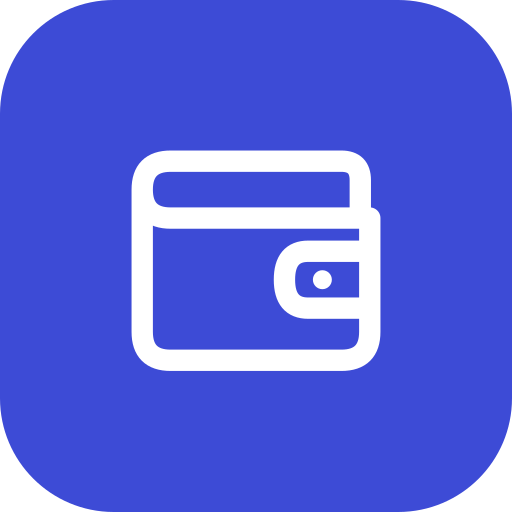

# Family Budget Tracker

Privacy-first, offline-first family budgeting for Android. Financial data currently stays on your device. Planned Google Drive synchronization will use encrypted files.

## Status

Home, manual transactions, budgets, recurring bills, receipt scanning, insights and savings goals are implemented. The reliability audit fixes are complete, with 134 JVM tests passing.

Exchange rates include cached NBS EUR/USD quotes and manual overrides under Settings. RSD summaries, including older months, are estimates using the latest available rates. Original transaction amounts remain unchanged.

Remaining MVP work: encrypted family sync and recovery, and physical-phone acceptance testing for receipt scanning and performance. Bank statement imports are outside the MVP. See [the roadmap](docs/plans/roadmap.md).

## Build

Requires JDK 17 and the Android SDK (platform 37).

```bash
make check   # JVM tests and lint
make run     # install on the connected device or emulator and screenshot
```

## Docs

- `docs/specs/` product and technical design
- `docs/decisions/` architecture decision records
- `docs/design/` UI mockups
