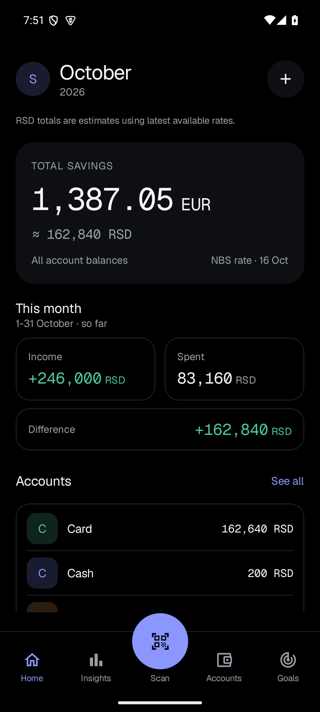
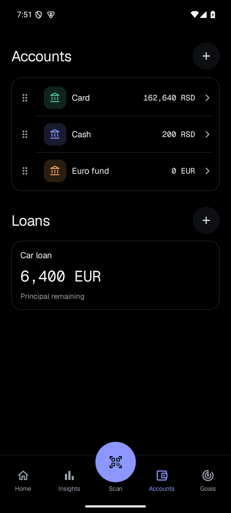
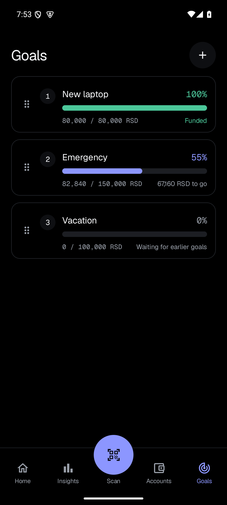

# Family Budget Tracker

A privacy-first Android app for everyday family finances. Track spending, see your savings and plan goals, with financial data stored on your device.

[Download APK](https://github.com/KljajicS/family-budget-tracker/releases) · [Roadmap](docs/plans/roadmap.md) · [Report an issue](https://github.com/KljajicS/family-budget-tracker/issues)

## Screenshots

<p>
  
  
  
</p>

Screenshots use demo data.

## Features

- Income, expenses, transfers and recurring bills.
- Multiple accounts and currencies, with total savings in EUR and RSD.
- Drag-to-reorder accounts and goals. Savings fill goals in priority order.
- Monthly insights, spending categories and transaction history.
- Serbian fiscal receipt QR scanning and manual loan repayment tracking.
- English and Serbian Latin, selectable in Settings, with light, dark and AMOLED themes.

## Privacy and status

Core tracking works offline, without an app account or dedicated backend. Receipt verification and exchange-rate updates require internet. Converted totals use the latest available rates and are estimates.

Optional app lock asks for a fingerprint or the phone screen lock to open the app. It gates access only: data stays in an unencrypted local database protected by the Android app sandbox. See [security](docs/security.md).

Under active development. Family synchronization, end-to-end encrypted sync, and data export/recovery are not available yet. Bank statement import is planned beyond the MVP.

## Build

Requires JDK 17, Android SDK platform 37 and Make. Runs on Android 8.0 or newer.

```bash
make check   # lint and JVM tests
make build   # debug APK
make run     # install and launch on a connected device or emulator
```

See [release signing](docs/releasing.md), [architecture decisions](docs/decisions/) and [product specifications](docs/specs/).
