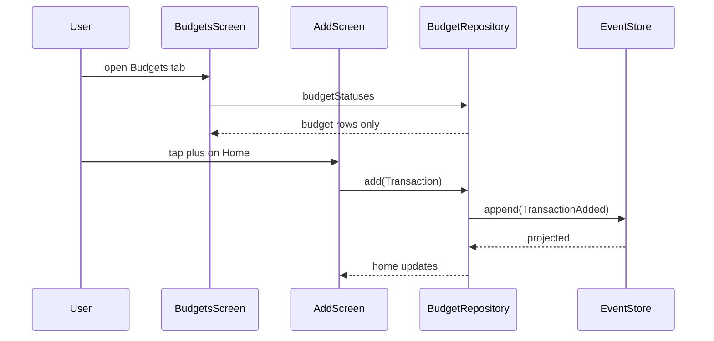
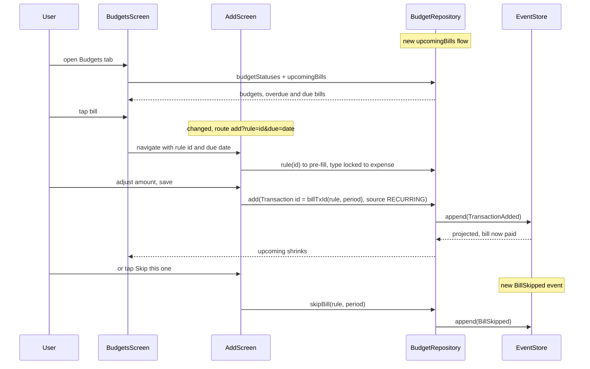
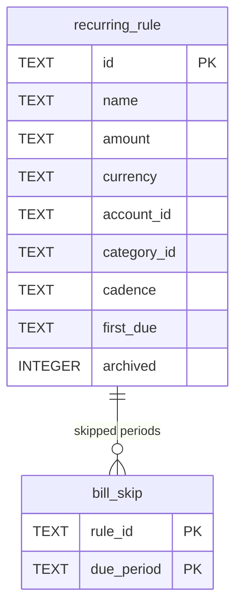

# Milestone 3: Recurring bills

Approved and built 2026-10-15. The design was challenged before building: 8 challenges accepted, 1 partly accepted, 0 rejected. The code is the source of truth where this document and the code differ.

## Goal
The family records bills that repeat (rent, internet, insurance) once, sees what is due on the Budgets tab, pays each with one tap into a pre-filled Add sheet, and safe to spend already holds that money back.

## Scope
- Recurring rule: name, amount with currency, account, category, cadence monthly or yearly, first due date. Expenses only.
- Rules managed under Settings, Recurring bills: list, + New, edit form with Delete (archive). Same pattern as Categories and Accounts.
- Upcoming section on the Budgets tab per the mockup: date badge, name, account, amount, total in RSD. Every occurrence from the rule's first due date to the end of the current month that is neither paid nor skipped. Occurrences before today are overdue, shown first in orange, and stay until paid or skipped.
- Tap a bill: Add sheet opens pre-filled (amount, currency, category, account, merchant = rule name, date = due date, source RECURRING), type locked to expense. Save writes a normal TransactionAdded whose id is derived from (ruleId, period), so both phones paying the same bill write the same row. The sheet has a "Skip this one" link that writes BillSkipped instead.
- Safe to spend subtracts unpaid bills: overdue ones in full, current-month ones only for the part not already covered by the category's remaining budget.

## Out of scope
- Automatic transaction generation. Derived lists cannot double-generate, stored ones can (ADR 8).
- Weekly cadence, end dates, income rules (confirmed by user). Archive covers "stop this bill".
- Reminders or notifications. Not in the mockups.
- Partial payments. The amount is adjustable at pay time, which is enough.

## Assumptions
- Cadence monthly and yearly, day clamped to month length: a rule anchored on the 31st is due on 28 February (confirmed by user).
- Pay flow is the pre-filled Add sheet, rules live under Settings, expenses only (confirmed by user).
- Unpaid bills from earlier months stay as overdue until paid or skipped (confirmed by user). The first due date is the lower bound, so a rule created with a first due date in the past shows its past occurrences as overdue; the form defaults the date to today.
- Payment identity is the period, not the date: `billTxId(ruleId, "2026-10")` for monthly, `billTxId(ruleId, "2026")` for yearly. Moving the due day from the 20th to the 25th does not reopen a paid month (review question, decided here).
- A bill is paid when a transaction with the derived id exists. Deleting that transaction makes the bill due again; that is the honest state.
- Currency follows the chosen account. An account's currency is locked while any transaction or active rule references it (review 4).
- Rules whose account is archived do not appear in Upcoming and do not reserve money; they stay in the Settings list so the user can move them to another account (review 5).

## Current behaviour
No recurring flow exists today. Safe to spend is liquid minus the budget reserve (`HomeCalculator.summarize`, `app/src/main/kotlin/rs/budget/domain/HomeSummary.kt:22`, fed by `BudgetRepository.home`). The Budgets tab lists budget rows and a "+ New" pill (`ui/budgets/BudgetsScreen.kt:53`). The Add sheet takes no arguments (`Routes.ADD = "add"` in `ui/Nav.kt`; `AddViewModel` has no `SavedStateHandle`) and lets the user switch expense, income, transfer (`AddScreen.kt:76`). `TransactionSource.RECURRING` exists in `domain/Entities.kt` and is unused. `Projector.apply` is an exhaustive `when` over the sealed `Event` (`data/Projector.kt:27`).

## Proposed design

Rules are events like everything else: `RecurringRuleSet(rule)` is a whole snapshot for create and edit, `RecurringRuleArchived(ruleId)` hides it, `BillSkipped(ruleId, period)` records a skipped occurrence. The projector keeps two read tables, `recurring_rule` and `bill_skip`. Nothing is generated: `BillCalculator.upcoming(today, rules, activeAccountIds, transactions, skips)` in `domain` walks each active rule's occurrences from its first due date to the end of the current month, derives the period and the transaction id per occurrence, and keeps those with no matching transaction and no skip row. `billTxId` is a name-based UUID over `ruleId:period` in `Ids.kt`; under ADR 8's create-never-overwrites rule two phones paying the same bill converge to one transaction.

`BillCalculator.reserve(bills, statuses, rates)` returns the RSD amount safe to spend must hold back: overdue bills in full; current-month bills grouped by category, minus the category's positive `left` from its budget status, floored at zero (review 2). Unconvertible currencies set `partial`. `HomeCalculator.summarize` gains a `bills` term subtracted with `committed`. Paying a bill from a spending account lowers liquid and releases the same reserve, so safe to spend does not move; skipping releases the reserve and raises it (review 3).

The Add sheet becomes `add?rule={ruleId}&due={date}` with both optional. `AddViewModel` takes a `SavedStateHandle`; when `rule` is present it loads the rule, pre-fills the state, locks the type to expense and the id and source, and exposes `skip()`. The Budgets tab renders Upcoming below the budget rows. Settings gets a "Recurring bills" row and two screens copied from the Accounts pair.

Alternative considered: stored pending transactions. Rejected: two offline phones generate twice, every query filters pending rows.

## Components and files
- `domain/Entities.kt`: `Cadence { MONTHLY, YEARLY }`, `RecurringRule(id, name, money, accountId, categoryId, cadence, firstDue: LocalDate, archived)`.
- `domain/Event.kt`: `RecurringRuleSet`, `RecurringRuleArchived`, `BillSkipped(ruleId, period)`.
- `domain/Ids.kt`: `billTxId(ruleId, period)`.
- `domain/BillCalculator.kt` (new): `occurrences(rule, until)`, `period(rule, dueDate)`, `upcoming(...)`, `reserve(...)`, `Bill(rule, dueDate, period, txId, overdue)`.
- `domain/HomeSummary.kt`: `bills` parameter.
- `sqldelight/.../RecurringRule.sq`, `BillSkip.sq` (new), `migrations/2.sqm` (new, CREATE TABLE only).
- `data/Projector.kt`: three branches, `clear()` wipes both tables.
- `data/BudgetRepository.kt`: `rules`, `upcomingBills`, `rule(id)`, `setRule`, `archiveRule`, `skipBill`; `home` passes the bill reserve.
- `ui/Nav.kt`: `ADD` with optional args, `addBill(ruleId, due)`, `RECURRING`, `NEW_RECURRING`, `EDIT_RECURRING`.
- `MainActivity.kt`: routes wired.
- `ui/add/AddViewModel.kt`, `AddScreen.kt`: pre-fill, locked type, fixed id, Skip link.
- `ui/budgets/BudgetsViewModel.kt`, `BudgetsScreen.kt`: `upcoming` and `upcomingTotal`, Upcoming section with `BillRow`.
- `ui/settings/RecurringScreens.kt` (new), `SettingsViewModels.kt` (`RecurringViewModel`, `EditRecurringViewModel`, account lock extended to rules), `SettingsScreen.kt` row.
- `res/values/strings.xml`, `values-sr/strings.xml`: `settings_recurring`, `recurring_*`, `bills_*`, `add_skip_bill`.
- `docs/decisions/0009-bills-and-budget-reserve.md`, `docs/decisions/README.md`, `docs/plans/2026-10-15-m3-recurring.md`, `docs/plans/roadmap.md`: closing commit.

## API changes
Three new event types in the JSON log. Older builds skip them during replay (ADR 8). None removed or changed.

## DB and data changes
`migrations/2.sqm` creates `recurring_rule(id PK, name, amount TEXT, currency, account_id, category_id, cadence, first_due TEXT, archived INTEGER DEFAULT 0)` and `bill_skip(rule_id, due_period TEXT, PRIMARY KEY(rule_id, due_period))`. CREATE TABLE only; it compiles without a schema snapshot like `1.sqm` did. The SQLDelight verify task is not part of our check command and would need snapshots, so the upgrade is checked on the emulator by installing over the previous build (review 7). Both tables are projector-owned and rebuilt from events; `Projector.VERSION` stays. No change to `tx`.

## External service impact
None.

## Implementation steps
1. Domain and storage together, since `Projector.apply` is exhaustive over `Event` (review 8): `Entities.kt`, `Event.kt`, `Ids.kt`, `BillCalculator.kt`, `HomeSummary.kt`, `RecurringRule.sq`, `BillSkip.sq`, `2.sqm`, `Projector.kt`, `BudgetRepository.kt`. Verify `./gradlew :app:testDebugUnitTest :app:checkDomainPurity :app:assembleDebug`, then install over the current emulator build and open Home. Done when `BillCalculatorTest`, `RecurringRepositoryTest`, the serialization round trips and the extended convergence test pass, and the upgraded app opens with its data.
2. Settings screens: `RecurringScreens.kt`, `SettingsViewModels.kt`, `SettingsScreen.kt`, `Nav.kt`, `MainActivity.kt`, strings. Verify full check, then on the emulator create, edit, delete a rule, and confirm the referenced account's currency is locked. Done when `RecurringViewModelsTest` passes and the list shows the rule.
3. Upcoming and pay: `BudgetsViewModel.kt`, `BudgetsScreen.kt`, `AddViewModel.kt`, `AddScreen.kt`, `Nav.kt`, `MainActivity.kt`, strings. Verify full check, then on the emulator pay one bill, skip one, watch Upcoming shrink and safe to spend hold on pay and rise on skip. Done when `AddViewModelTest` pre-fill, locked type and skip cases and `BudgetsViewModelTest` upcoming case pass.
4. Close: ADR 9, plan copied to `docs/plans/2026-10-15-m3-recurring.md`, roadmap row done. Done when `make check` is green.

## Commits
1. `Add recurring rules, skipped bills and the bill reserve` (step 1)
2. `Manage recurring bills under settings` (step 2)
3. `List upcoming bills on budgets and pay them through the add sheet` (step 3)
4. `Close recurring bills milestone` (step 4)

## Tests
- `BillCalculatorTest` (domain): monthly occurrences clamp the 31st to month end; yearly fires only in its month; a first due date after month end yields nothing; occurrences before today are overdue and included; a first due date months back lists each unpaid month; paid detection by derived id; a skip hides one period only; moving the due day keeps a paid month paid; reserve counts overdue in full, subtracts the category's remaining budget for current-month bills, floors at zero, counts an exhausted budget's bill in full, excludes archived accounts, flags unconvertible currency. Failure modes: double count against budgets, leak through an exhausted budget, wrong clamp, bill reappearing after payment or due-day edit.
- `IdsTest`: `billTxId` stable for the same input, different across periods.
- `EventSerializationTest`: round trip of the three events with the `type` discriminator.
- `RecurringRepositoryTest` (data): set, edit, archive, skip project correctly; `upcomingBills` drops a paid bill; `home.safeToSpend` drops by the unpaid bill, stays after paying from a spending account, rises after a skip; an archived account hides its rule's bills.
- `EventStoreTest`: `tables()` compares rule and skip tables too; two `TransactionAdded` with the same bill id from two devices leave one row (review 9).
- `AddViewModelTest`: route args pre-fill, type locked, save uses the derived id and `RECURRING`, skip writes `BillSkipped`; existing manual cases unchanged.
- `BudgetsViewModelTest`: upcoming list, overdue first, RSD total.
- `RecurringViewModelsTest`: validation (name, positive amount, account, category), currency follows account, edit loads the rule; account currency locked when a rule references it.

## Observability
None. Local app, no telemetry.

## Rollout
No flag. Debug build on the emulator, then the family phone. Nothing shows until a rule is created.

## Migration
`2.sqm` runs on first launch after update, before any query. Adds tables only. Older builds reading a newer log skip the new events.

## Rollback
No in-place downgrade: the SQLite driver refuses to open a version 3 file with the version 2 schema (review 1). Rolling back means uninstalling, reinstalling the previous build and re-entering data until sync exists, which is why the upgrade is tested on the emulator before the phone. The event log format itself is untouched.

## Risks
- Double counting bills against budgets: mitigated by per-category uncovered amount with tests.
- Old unpaid bills piling up: the user has to skip or pay each; the form defaults the first due date to today so a new rule starts clean.
- Add sheet grows another mode: mitigated by keeping the existing `AddViewModelTest` cases.
- Upgrade on the phone: migration adds tables only; verified by install-over on the emulator.

## Unresolved questions
None.

## Review challenges
Accepted: 8. No in-place downgrade (1, Rollback rewritten). Exhausted budgets reserve zero, so bills subtract only the uncovered part (2). Paying does not move safe to spend, skipping raises it (3, tests fixed). Account currency lock covers rules (4). Archived accounts hide their rules' bills (5). Type locked to expense in bill mode (6). Events and projector land in one step (8). Convergence test covers rule tables and duplicate payments (9). Partly accepted: migration verification is not in our check command, so the upgrade is tested on the emulator instead of adding schema snapshots now (7). review questions decided: payment identity is the period, so a due-day edit keeps paid months paid; overdue bills stay until paid or skipped (user).
