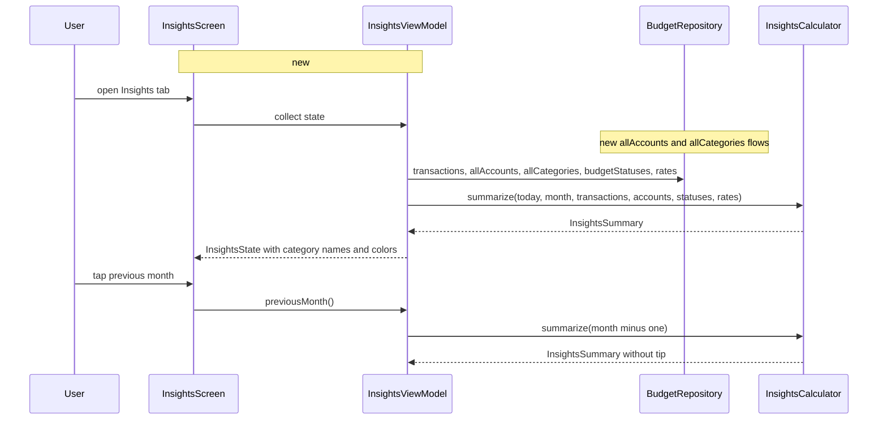

# Milestone 5: Insights

Approved and built 2026-10-15. The design was challenged before building: 5 challenges accepted, 1 simpler option adopted, 0 rejected. The code is the source of truth where this document and the code differ.

## Goal
The Insights tab shows where this month's money went, income against expenses over the last six months, how savings have grown, and one plain-language tip, for any month since the first transaction.

## Scope
- Month header with previous and next arrows, bounded by the first month with a transaction and the current month.
- "Where the money went": donut of the selected month's expenses by category, top four plus Other, legend with percentages, total in the middle.
- "Income vs expenses": six bar pairs ending at the selected month; the month in progress drawn lighter; caption with the average saved per completed month in the window.
- "Savings trend": savings-account balance at each month end over the same six months, line with area fill, delta since the first month in the window.
- One tip card for the current month, first rule that matches: a budget at 90% or more with days left; a category above its three-month average; otherwise what was saved this month against the average.
- All math in a pure `InsightsCalculator` in `domain`; charts drawn with Compose `Canvas`, no chart library.

## Out of scope
- Chart library. The spec's dependency list (section 6.8) allows nothing without a decision record, and three shapes do not need one.
- Tips for past months. Budget pace only exists for the current month.
- Per-category drill-down, export, comparisons across years. Not in the mockup.
- Rate history. Amounts convert at today's RSD-only rates like the rest of the app; non-RSD amounts are skipped and the screen shows the existing "some accounts have no rate" caption.

## Assumptions
- Three tip rules in priority order, always one card for the current month (confirmed by user).
- Arrows go back to the first transaction's month and forward to the current month (confirmed by user). A future-dated transaction never moves the lower bound past today: range is `min(firstTxMonth, currentMonth)..currentMonth`, and an empty history gives the current month alone (review 3).
- History uses all categories and all accounts, archived ones included, so renamed, recolored or deleted ones keep their name and color in old months and an archived savings account still counts in past balances (review 1, 2). Home keeps excluding archived accounts; that is a "now" view, this is a "then" view.
- An account's current kind applies to its whole history: switching an account from spending to savings moves its past balance into the savings line. Simple and visible; revisit if it ever confuses (review question).
- "Other" in the donut is every category beyond the top four, plus expenses with no category. Colors come from `Category.color`; Other uses the muted token.
- "Average saved" is the mean of income minus expenses over the completed months in the six-month window; the month in progress is excluded.
- Savings balance per month end comes from `HomeCalculator.balances` run over the transactions dated at or before that month end, summed over savings accounts (review simpler option). Six scans of a few thousand rows is nothing.
- A month with no transactions still gets a bar pair of zero and a point on the savings line, so the axis never skips months. Zero totals draw an empty donut and flat charts without dividing by zero (review 4).
- Rule 2 (above average) needs at least one of the previous three months with spending in that category, and fires when the current month's spend exceeds that average.

## Current behaviour
The Insights tab is a stub (`MainActivity.kt:139`, `Stub` composable at `MainActivity.kt:197`). No existing flow changes; this is a brand-new screen reading existing data. `BudgetRepository` exposes `transactions`, `accounts` (active only, `data/BudgetRepository.kt:69`), `categories` (active only, `:72`), `budgetStatuses` and `rates`. `HomeCalculator.balances` (`domain/HomeSummary.kt:59`) is the balance arithmetic to reuse.

## Proposed design

`InsightsCalculator.summarize` is the single pure entry point. It takes today, the selected month, transactions, all accounts, the current budget statuses and rates, and returns an `InsightsSummary`: `spent` (RSD), `slices` (category id or null for Other, amount, share), `months` (six `MonthTotals` of income and expenses, in-progress flag on the current month), `averageSaved`, `savings` (six month-end balances, each from `HomeCalculator.balances` over transactions up to that month end, summed over savings accounts in RSD), `savingsDelta`, `tip` (sealed `Tip`: `BudgetNearLimit`, `AboveAverage`, `Saved`, or null outside the current month), `partial`, and `range`.

`BudgetRepository` gains `allAccounts` and `allCategories` flows backed by two new `SELECT *` queries (`Account.sq`, `Category.sq`), archived rows included. `InsightsViewModel` keeps `month` in a `MutableStateFlow`, defaulting to the current month, combines it with the repository flows, and clamps `previousMonth()` and `nextMonth()` to `range`. The screen is a `LazyColumn` of four cards following the mockup, with three small `Canvas` composables in `ui/insights/Charts.kt`: `Donut`, `BarPairs`, `TrendLine`. Each chart's `contentDescription` is built from the numbers it draws: slices with percentages, each month with income and expenses, each month with its savings balance (review 5). Charts guard a zero maximum and draw tracks only.

Alternative: a chart library. Rejected: a new dependency for three shapes, and the mockup's look is easier to match by hand.

## Components and files
- `app/src/main/kotlin/rs/budget/domain/InsightsCalculator.kt` (new): `summarize`, `InsightsSummary`, `Slice`, `MonthTotals`, `Tip`.
- `app/src/main/sqldelight/rs/budget/data/db/Account.sq`, `Category.sq`: `all` query each.
- `app/src/main/kotlin/rs/budget/data/BudgetRepository.kt`: `allAccounts`, `allCategories`.
- `app/src/main/kotlin/rs/budget/ui/insights/InsightsViewModel.kt` (new): state, month navigation.
- `app/src/main/kotlin/rs/budget/ui/insights/InsightsScreen.kt` (new): month header, four cards, legend, tip card.
- `app/src/main/kotlin/rs/budget/ui/insights/Charts.kt` (new): `Donut`, `BarPairs`, `TrendLine` with numeric content descriptions.
- `app/src/main/kotlin/rs/budget/MainActivity.kt`: replace the Insights stub.
- `app/src/main/kotlin/rs/budget/ui/Format.kt`, `ui/budgets/BudgetsScreen.kt`: `monthName` moves to `Format.kt` so both screens share it.
- `app/src/main/res/values/strings.xml`, `values-sr/strings.xml`: `insights_*` strings.
- `docs/plans/2026-10-15-m5-insights.md`, `docs/plans/roadmap.md`: closing commit.

## API changes
None. No new events.

## DB and data changes
Two read queries (`SELECT * FROM account`, `SELECT * FROM category`). No schema change, no migration.

## External service impact
None.

## Implementation steps
1. Calculator and data: `domain/InsightsCalculator.kt`, the two `all` queries, `allAccounts` and `allCategories` in `BudgetRepository`, tests. Verify `./gradlew :app:testDebugUnitTest :app:checkDomainPurity`. Done when `InsightsCalculatorTest` passes and `ManagementTest` shows an archived account in `allAccounts`.
2. Screen: `InsightsViewModel.kt`, `InsightsScreen.kt`, `Charts.kt`, `MainActivity.kt`, `monthName` moved to `Format.kt`, strings. Verify the full check, then on the emulator open Insights, step back a month and forward, compare against `docs/design/insights-light.png` and the AMOLED variant, and open it on a fresh install with no transactions. Done when `InsightsViewModelTest` passes and the screen matches the mockup.
3. Close: plan copied to `docs/plans/2026-10-15-m5-insights.md`, roadmap row done. Done when `make check` is green.

## Commits
1. `Add the insights calculator and history flows` (step 1)
2. `Add the insights screen with spending, income and savings charts` (step 2)
3. `Close insights milestone` (step 3)

## Tests
- `InsightsCalculatorTest` (domain): slices are the top four categories plus Other and shares sum to 100; uncategorized expenses land in Other; income and transfers never count as spending; the six-month window includes empty months as zero and marks the current month in progress; average saved excludes the in-progress month; savings balance is cumulative and the delta is last minus first; a transfer into savings raises the line; an archived savings account still counts in past months; tip priority: budget at 90% beats above-average beats saved; above-average needs prior months; no tip for a past month; range clamps a future-dated first transaction and an empty history to the current month; all-zero input gives zero slices, zero bars and a flat line without throwing; non-RSD amounts set `partial`. Failure modes: a share total over 100, a skipped month shifting bars, savings counting spending accounts, tips on the wrong month, divide by zero on empty data.
- `ManagementTest` (data): `allAccounts` and `allCategories` include archived rows while `accounts` and `categories` do not.
- `InsightsViewModelTest` (ui): default month is the current one; previous stops at the first month with data; next stops at the current month; the state carries the summary for the selected month and resolves category names and colors for archived categories.
- `FormatTest`: the moved `monthName` case for Serbian Latin.

## Observability
None. Local app.

## Rollout
No flag. Emulator, then the family phone. The tab shows an empty hint until there is a transaction.

## Migration
None.

## Rollback
Reinstall the previous build. No data written.

## Risks
- Canvas charts on small screens: fixed card heights from the mockup; checked on the emulator at the Pixel 7 size and with font scale raised.
- Six-month window with only one month of data: bars and line degrade to one point; tested.
- Performance: six balance scans per recomposition of the flow over all transactions; at family volume milliseconds. Revisit if it ever shows.

## Unresolved questions
None.

## Review challenges
Accepted: 5. Categories and accounts for history include archived rows through two new flows (1, 2). Range clamps future-dated first transactions and empty histories (3). Zero and constant inputs are tested and charts guard a zero maximum (4). Chart descriptions are built from the numbers drawn (5). Simpler option adopted: month-end savings reuse `HomeCalculator.balances`. review question decided: an account's current kind applies to its whole history. Rejected: 0.
