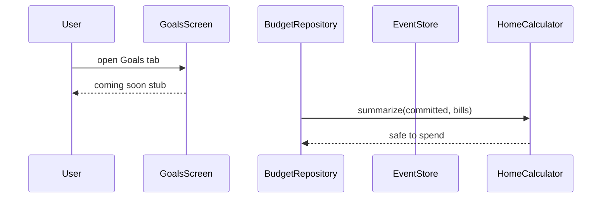
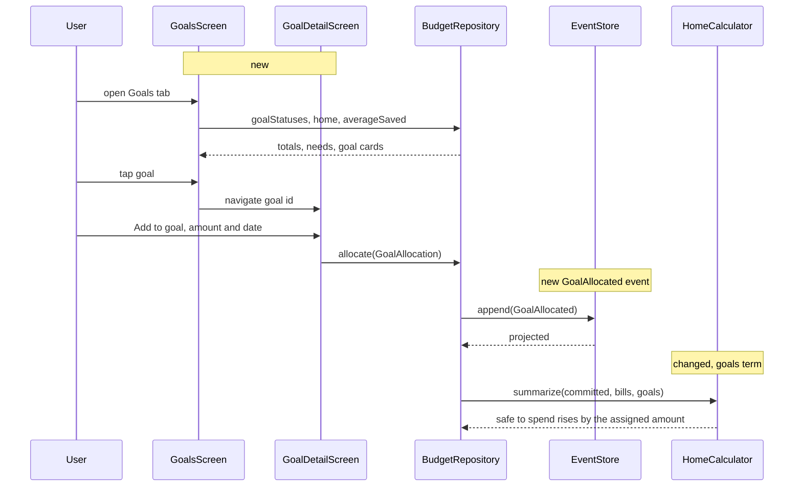
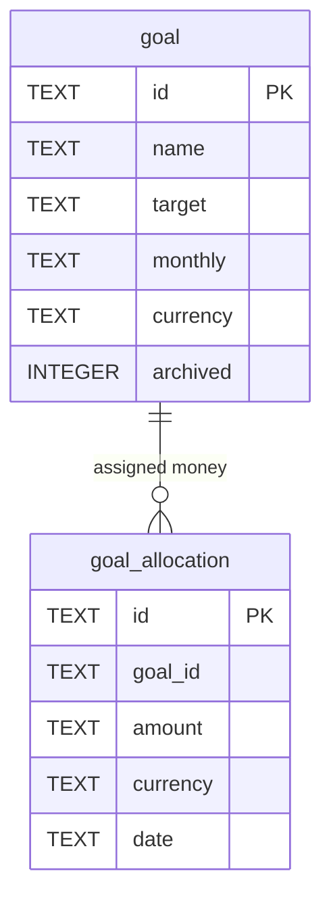

# Milestone 6: Goals

Approved and built 2026-10-15. The design was challenged before building: 5 challenges accepted, 0 rejected. The code is the source of truth where this document and the code differ.

## Goal
The family sets savings goals with a target and a monthly contribution, assigns money to them explicitly, sees progress and an arrival month per goal, how much of their savings is still unassigned, and whether their average saving covers what the goals ask; safe to spend holds back this month's contributions not yet assigned.

## Scope
- Goal: name, target amount with its own currency, monthly contribution in the same currency, archived. Events `GoalSet` (snapshot for create and edit), `GoalArchived`.
- Allocation: explicit "Add to goal" entries with amount and date in the goal's currency. Events `GoalAllocated`, `GoalAllocationDeleted`.
- Goals tab per the mockup: "+ New goal", Total savings card (per-currency bar and legend with RSD conversions, unassigned line), needs card (goals ask X per month, you save about Y, short or covered), one card per goal with progress, allocated of target, contribution and arrival month.
- Goal detail screen: progress, Add to goal form (amount, date), allocation list with delete, Edit and Delete goal.
- Safe to spend subtracts, per unreached goal, the part of this month's contribution not yet assigned (ADR 7 `unallocatedGoalContributions`).
- Pure `GoalCalculator` in `domain`.

## Out of scope
- Linking a goal to an account and auto-assigning transfers (confirmed by user). The spec's optional `accountId` stays out; explicit entries are the record.
- Blocking over-assignment (confirmed by user): a warning instead.
- A Completed section (confirmed by user): a reached goal stays at 100% and stops asking for money.
- Rate line "1 EUR = 117.20" on the total card: rates are RSD-only until milestone 7; the existing partial caption covers missing rates.

## Assumptions
- Each goal has a currency; target, contribution and allocations share it (confirmed by user). The allocation form has no currency choice. Goal currency locks once the goal has allocations, same pattern as accounts.
- Over-assignment allowed: the total card shows "assigned X more than saved" in orange when allocations exceed savings (confirmed by user).
- Reached means allocated at or above target: 100%, "Reached" instead of an arrival month, excluded from the needs line and from safe to spend (confirmed by user).
- Arrival month = current month plus `ceil((target - allocated) / monthly)`; no arrival when monthly is zero.
- "You save about Y on average" reuses `InsightsCalculator.summarize(...).averageSaved`, the mean of income minus expenses over completed months in the last six.
- Unassigned savings = Home's savings total in RSD minus the allocations of active goals converted to RSD. Deleting a goal releases its money back to unassigned (review 1). Allocations and savings are independent records; the number is a comparison, not a ledger.
- Safe to spend holds `max(0, monthly - allocatedThisMonth)` per unreached goal, converted to RSD. Assigning money this month releases the hold up to the contribution, never more: 150 assigned against a 100 contribution raises safe to spend by 100 (review 5). Moving money to savings lowers liquid. That matches ADR 7 and mirrors the bills rule in ADR 9.
- Every RSD total the calculator produces (hold, needs, unassigned) carries a partial flag when an amount had no rate; Home ORs the hold's flag into its existing `partial`, and the Goals tab shows the same caption for needs and unassigned (review 2, 3).
- An allocation whose currency differs from its goal's (possible only through a merge of two offline edits) is skipped in every sum, never thrown on, the same rule `HomeCalculator.balances` applies to transactions (review 4). The form cannot produce one.
- Deleting an allocation is final under ADR 8 (delete wins); a later edit cannot resurrect it because allocations have no edit event.

## Current behaviour
The Goals tab is a stub (`MainActivity.kt:167`). Safe to spend is `liquid - committed - bills` (`domain/HomeSummary.kt:53`); `BudgetRepository.home` combines five flows (`data/BudgetRepository.kt:124`), which is the `combine` overload limit, so the goals term needs one nested combine. `Projector.apply` is exhaustive over `Event` (`data/Projector.kt`), `Projector.VERSION` is 3 (`:83`). Migrations: `1.sqm`, `2.sqm` CREATE TABLE only. The Recurring screens under `ui/settings/RecurringScreens.kt` are the list and form pattern to copy.

## Proposed design

`GoalCalculator.statuses(today, goals, allocations)` returns one `GoalStatus` per active goal: allocated total in the goal's currency (allocations in another currency skipped), ratio, reached flag, arrival month. `GoalCalculator.needs(statuses, rates)` sums the monthly contributions of unreached goals in RSD. `GoalCalculator.hold(today, statuses, allocations, rates)` is the safe-to-spend term: per unreached goal `max(0, monthly - allocated this month)` in RSD. `GoalCalculator.unassigned(savingsTotal, statuses, rates)` is savings minus the allocations of active goals in RSD, negative when over-assigned. All three return the RSD amount with a partial flag, like `BillCalculator.reserve`. `HomeCalculator.summarize` gains `goals` and the flag folds into the existing `partial`.

Storage follows recurring rules: read tables `goal` and `goal_allocation`, migration `3.sqm` with CREATE TABLE only, projector branches where `GoalSet` is insert-or-ignore plus an update that leaves `archived` alone, `GoalAllocated` is insert-or-ignore, `GoalAllocationDeleted` deletes. `BudgetRepository` gains `goals`, `allocations`, `goalStatuses`, `setGoal`, `archiveGoal`, `allocate`, `deleteAllocation`, and `home` nests one more combine to pass the goals term to `HomeCalculator.summarize`, which gains a `goals` parameter subtracted with `committed` and `bills`.

Screens: `GoalsScreen` (tab) with the total card, needs card and goal cards; `GoalDetailScreen` with the Add to goal form, allocation rows with delete, Edit and Delete; `EditGoalScreen` copied from the recurring form with name, target, monthly, currency pills. Three view models in `ui/goals/GoalsViewModels.kt`. The needs card reads `averageSaved` from `InsightsCalculator.summarize` for the current month.

Alternative considered: deriving progress from transfers into a linked savings account. Rejected by the user; explicit entries are unambiguous with several goals.

## Components and files
- `domain/Entities.kt`: `Goal`, `GoalAllocation`.
- `domain/Event.kt`: `GoalSet`, `GoalArchived`, `GoalAllocated`, `GoalAllocationDeleted`.
- `domain/GoalCalculator.kt` (new): `GoalStatus`, `statuses`, `needs`, `hold`, `unassigned`.
- `domain/HomeSummary.kt`: `goals` parameter in `summarize`.
- `sqldelight/.../Goal.sq`, `GoalAllocation.sq` (new), `migrations/3.sqm` (new).
- `data/Projector.kt`: four branches, `clear()` wipes both tables.
- `data/BudgetRepository.kt`: flows, writes, `home` term.
- `ui/Nav.kt`: `NEW_GOAL`, `GOAL`, `EDIT_GOAL` with helpers.
- `MainActivity.kt`: Goals tab and routes.
- `ui/goals/GoalsViewModels.kt`, `GoalsScreen.kt`, `GoalDetailScreen.kt`, `EditGoalScreen.kt` (new).
- `res/values/strings.xml`, `values-sr/strings.xml`: `goals_*`, `goal_*`.
- `docs/plans/2026-10-15-m6-goals.md`, `docs/plans/roadmap.md`: closing commit.

## API changes
Four new event types in the JSON log. Older builds skip them during replay (ADR 8). None removed or changed.

## DB and data changes
`migrations/3.sqm` creates `goal(id PK, name, target TEXT, monthly TEXT, currency, archived INTEGER DEFAULT 0)` and `goal_allocation(id PK, goal_id, amount TEXT, currency, date TEXT)`. CREATE TABLE only, no snapshot needed, checked by installing over the previous build on the emulator. Both projector-owned; `Projector.VERSION` stays at 3 because the new tables start empty.

## External service impact
None.

## Implementation steps
1. Domain, storage and the safe-to-spend term: `Entities.kt`, `Event.kt`, `GoalCalculator.kt`, `HomeSummary.kt`, `Goal.sq`, `GoalAllocation.sq`, `3.sqm`, `Projector.kt`, `BudgetRepository.kt`, tests. Verify `./gradlew :app:testDebugUnitTest :app:checkDomainPurity :app:assembleDebug`, install over the current emulator build, open Home. Done when `GoalCalculatorTest`, `GoalRepositoryTest`, the serialization round trips and the extended convergence test pass and the upgraded app opens with its data.
2. Goals tab: `GoalsViewModels.kt` (`GoalsViewModel`), `GoalsScreen.kt`, `MainActivity.kt`, strings. Verify the full check, then on the emulator compare with `docs/design/goals-light.png` and the AMOLED variant. Done when `GoalsViewModelTest` passes and the tab matches the mockup with seeded goals.
3. Goal forms: `EditGoalScreen.kt`, `GoalDetailScreen.kt`, the two view models, `Nav.kt`, `MainActivity.kt`, strings. Verify the full check, then on the emulator create a goal, assign money twice, delete one entry, watch safe to spend fall when the goal is created and rise when money is assigned. Done when `GoalFormsTest` passes.
4. Close: plan copied to `docs/plans/2026-10-15-m6-goals.md`, roadmap row done. Done when `make check` is green.

## Commits
1. `Add goals, allocations and the goal hold in safe to spend` (step 1)
2. `Add the goals tab with savings totals and goal progress` (step 2)
3. `Create, edit, fund and delete goals` (step 3)
4. `Close goals milestone` (step 4)

## Tests
- `GoalCalculatorTest` (domain): ratio and reached at and above target; arrival month rounds up and is null for zero monthly; needs excludes reached goals and converts EUR; hold is `monthly - allocated this month` floored at zero (150 against 100 releases 100), zero for reached goals, allocations in other months do not count, unconvertible currency flags partial on hold, needs and unassigned; unassigned goes negative when over-assigned and ignores archived goals' allocations; an allocation in the wrong currency is skipped without throwing. Failure modes: a reached goal still asking for money, a past allocation reducing this month's hold, an ETA off by one month, a deleted goal keeping money assigned, a crash on a merged currency mismatch.
- `EventSerializationTest`: round trip of the four events.
- `GoalRepositoryTest` (data): set, edit, archive, allocate, delete allocation project correctly; `home.safeToSpend` falls by the contribution when a goal is created and rises back when this month's allocation is recorded; an EUR goal sets `home.partial`; an edit after archive keeps the goal archived.
- `EventStoreTest`: convergence case extended with a goal, an allocation from each device and a delete; tables compared.
- `GoalsViewModelTest` (ui): totals by currency, unassigned, needs line short and covered, cards ordered by ratio descending.
- `GoalFormsTest` (ui): create validates name, positive target, non-negative monthly; currency follows pills and locks once allocations exist; detail adds an allocation in the goal's currency with today's date by default and deletes one; delete archives the goal.

## Observability
None. Local app.

## Rollout
No flag. Emulator, then the family phone. The tab shows an empty hint until a goal exists.

## Migration
`3.sqm` runs on first launch after update, before any query. Adds tables only. Older builds reading a newer log skip the new events.

## Rollback
No in-place downgrade (ADR 8 note): the previous build cannot open a version 4 database. Uninstall and reinstall the previous build, re-enter data until sync exists. The log format is untouched.

## Risks
- Double counting with the budget reserve: a goal contribution is not a category, so it cannot overlap a budget; no exclusion rule needed. Low.
- Over-assignment confusing the total card: handled by the orange warning line and tested.
- `combine` overload limit in `home`: a nested combine, tested through `GoalRepositoryTest`.
- Upgrade on the phone: CREATE TABLE only, checked by install-over on the emulator.

## Unresolved questions
None.

## Review challenges
Accepted: 5. Deleting a goal releases its allocations from the unassigned figure (1). The hold's partial flag reaches Home's `partial` (2). Needs and unassigned carry their own partial flag shown on the Goals tab (3). Allocations in a currency other than the goal's are skipped, never thrown on, with a test after a merge (4). The release on assignment is capped at the contribution and tested (5). Rejected: 0. review question answered: a deleted goal's money becomes unassigned; the goal is archived, its allocations stay in the log but count for nothing.
